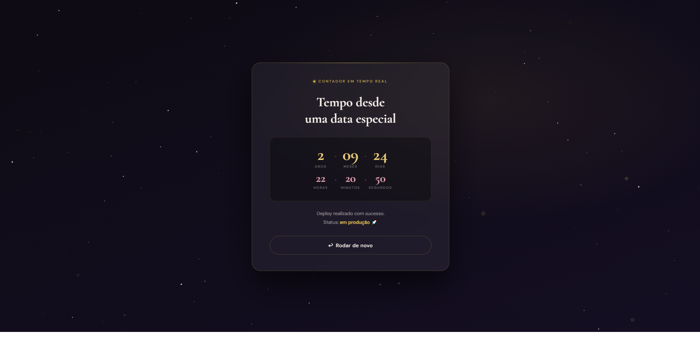

# Site Animado

Site de página única com animações, efeito de digitação, uma flor desenhada só com CSS e um contador em tempo real. Foi feito para praticar HTML, CSS e JavaScript sem frameworks.

**Demonstração:** https://giovannilidio.github.io/site-animado/




## Funcionalidades

- **Efeito de digitação:** os textos são escritos letra por letra, com cursor piscando
- **Flor em CSS:** as pétalas aparecem uma a uma, sem imagens
- **Contador em tempo real:** anos, meses, dias, horas, minutos e segundos desde uma data, atualizado a cada segundo e calculado por calendário (meses de 28, 30 e 31 dias)
- **Fundo animado:** estrelas que piscam, partículas que sobem e troca suave de cores entre as telas
- **Navegação em 4 telas** com transição de escurecimento
- **Tema configurável:** textos, nome e data ficam num único bloco `CONFIG`
- **Música opcional:** informe o arquivo em `CONFIG.musica`

## Tecnologias

- HTML5
- CSS3 (animações, `backdrop-filter`, variáveis CSS)
- JavaScript puro (sem bibliotecas)
- GitHub Pages (publicação)

## Como rodar localmente

```bash
git clone https://github.com/GiovanniLidio/site-animado.git
cd site-animado
```

Depois, abra o arquivo `index.html` no navegador. Não precisa instalar nada.

## Como personalizar

No começo do `<script>` do `index.html`, edite o bloco `CONFIG`:

```js
const CONFIG = {
  autor: 'Seu Nome',
  dataInicial: '2024-01-01T00:00:00',
  musica: '',
  // textos de cada tela...
};
```

## O que aprendi

- Manipulação do DOM e uso de `setInterval` e `setTimeout`
- Animações e transições com CSS
- Cálculo de diferença entre datas
- Separação entre configuração e lógica do código

## Autor

**Giovanni Lidio dos Santos**
[LinkedIn](https://linkedin.com/in/giovannilidio) · [GitHub](https://github.com/GiovanniLidio)